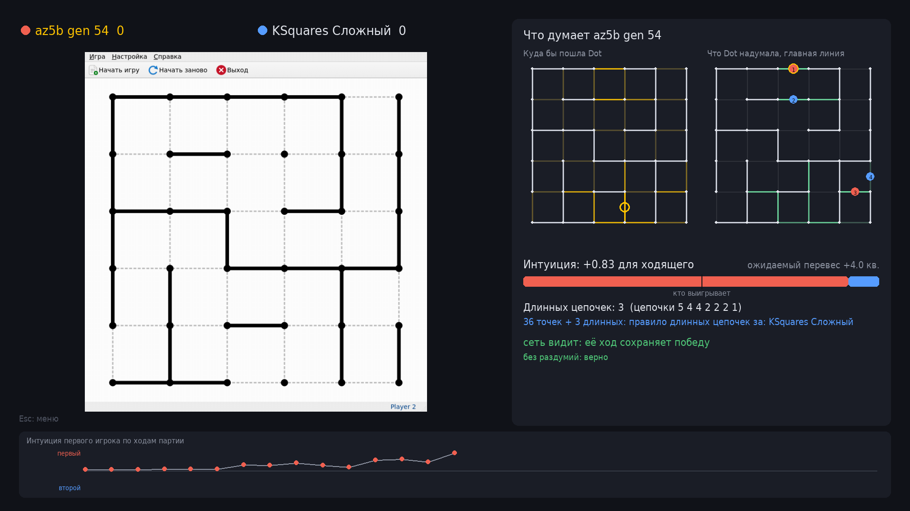
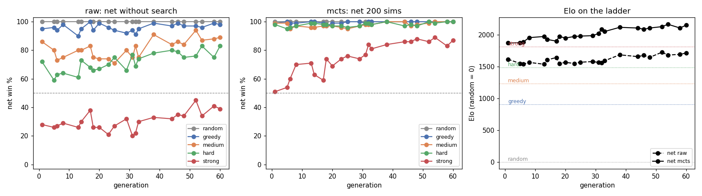
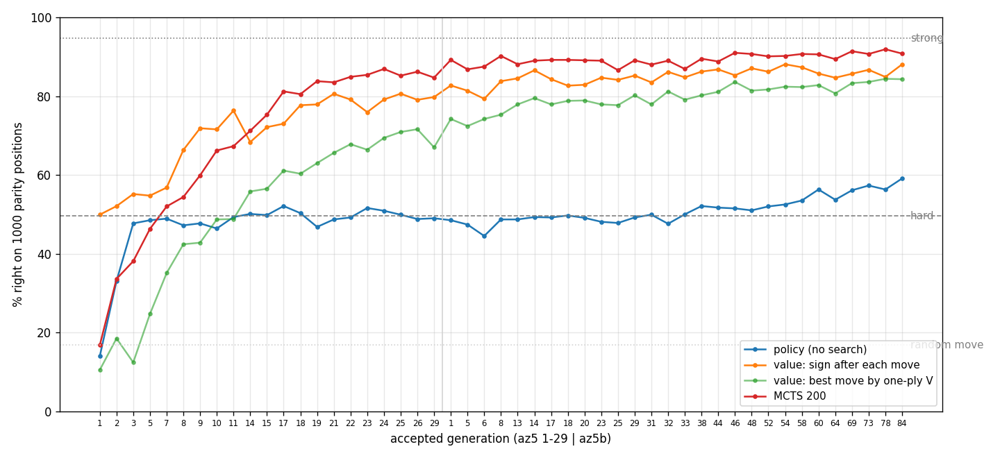
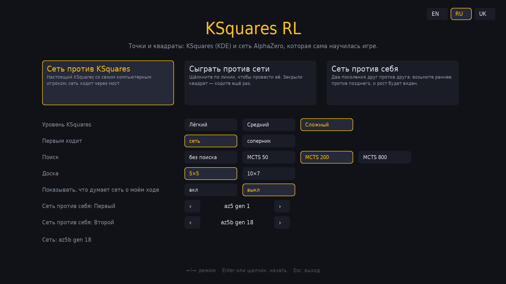
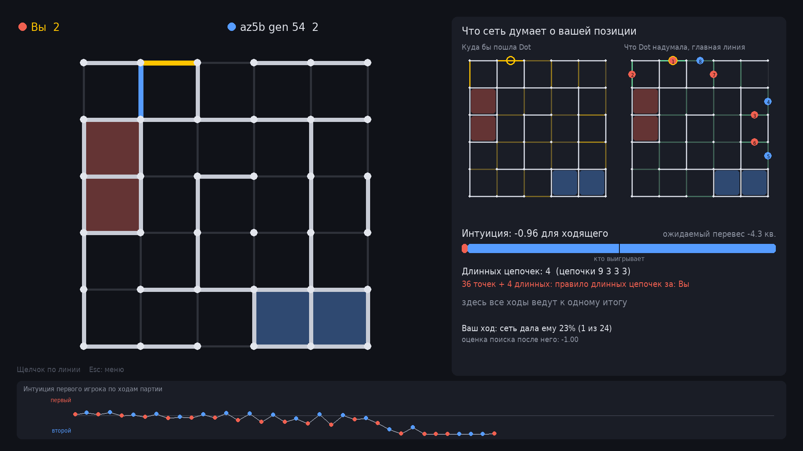
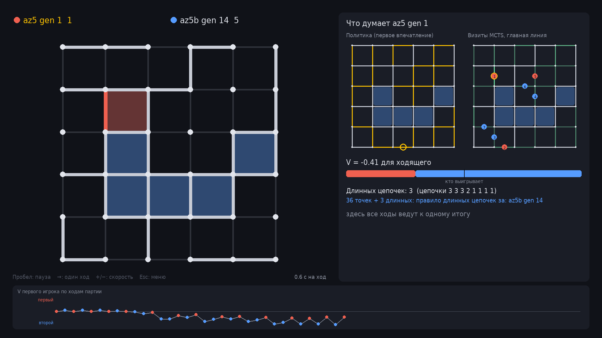
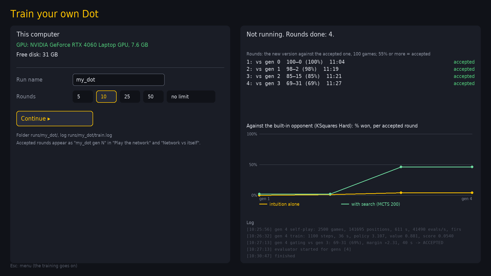

# ksquares-rl

An AlphaZero network that taught itself Dots and Boxes, playing the real
[KSquares](https://apps.kde.org/ksquares/) 21.12.3 (KDE) through a small
socket bridge built into the game. Trained on 5x5 by self-play only: no
human games and no hand-written chain rules. With 200 MCTS simulations it
beats KSquares Hard 99 games out of 100 and an alpha-beta reference player
("strong") 89 out of 100.



What is in here:

- `game/`: the KSquares sources (upstream tarball, unchanged in the first
  commit) plus the RL bridge (`game/src/rlbridge.cpp`, every change marked
  `// RL bridge`); `env/bridge.py` talks to it over a Unix socket.
- `sim/`: a pure-Python simulator with KSquares' own line numbering, and a
  move-exact port of the KSquares Easy / Medium / Hard AI
  (`sim/ksquares_ai.py`), checked against the real game on 1200 games
  (130,200 moves, all identical).
- `agents/`: baselines, the strong alpha-beta player (`agents/strong.py`),
  the AlphaZero network and MCTS.
- `scripts/`: training (`az_train.py`, `az_eval.py`), evaluation, the
  probes, the app (`launcher.py`). Every hyperparameter is in `configs/*.yaml`.
- `docs/`: `game_spec.md` (rules, storage, main loop and the built-in AI as
  KSquares implements them), `results.md` (all tables), `overnight.md` (the
  experiment log, decisions and dead ends).

## Results

The ladder on 5x5 (`docs/results.md`): win % of the network, 100 games per
cell, first mover alternating; raw = the policy's argmax, no search;
MCTS = 200 simulations. Elo is Bradley-Terry against fixed anchors
(random 0, greedy 905, Medium 1235, Hard 1488, strong 1815).

| network | raw vs Hard | raw vs strong | raw Elo | MCTS vs Hard | MCTS vs strong | MCTS Elo |
|---|---:|---:|---:|---:|---:|---:|
| az5 gen 29 (first run) | 63 | 24 | 1517 | 93 | 49 | 1829 |
| az5b gen 1 | 72 | 28 | 1614 | 98 | 51 | 1870 |
| **az5b gen 54 (the released one)** | 83 | 34 | 1680 | 99 | **89** | **2164** |



Full tables: `docs/az5_ladder.md`, `docs/az5b_ladder.md`.

**Parity curves.** Dots and Boxes on 5x5 is decided by the long chain rule:
who has to open the first long chain. `docs/parity_curves.md` takes 1000
positions where nothing can be captured, safe lines are left and the move
decides exactly that, and asks every accepted generation how often it picks
a winning move. The policy alone stays near 50% (it does not "see" parity),
while the value head learns it (88% balanced accuracy at gen 54) and MCTS
turns that into 90% winning moves; KSquares Hard gets 49.6%, strong 94.7%.



## The app

One pygame window with a menu (English, Russian, Ukrainian):

- **Network vs KSquares**: the real KSquares on a private Xvfb, its window
  grabbed into the centre; level Easy / Medium / Hard, who moves first.
- **Play the network**: click a line; optionally see what the network
  thinks of your own moves.

  In both the network is Dot from the release by default, or any accepted
  round of your own runs (see "Train your own Dot").
- **Network vs itself**: two generations against each other; pause, one
  move, speed.

The thought panel shows the policy as a heat map over the lines, the value
with a "who is winning" bar, the MCTS visits with the principal variation
numbered on the board, the long chains with the side the long chain rule
favours, and whether the move keeps the win (exact solving once at most 34
lines are left). Search: none or MCTS 50 / 200 / 800. The network plays 5x5
only: its heads are tied to the board size.

| menu | play the network | network vs itself |
|---|---|---|
|  |  |  |

The network is `runs/best/best.pt` (az5b gen 54, pinned in
`configs/app.yaml`). `runs/` is not in git: in a fresh clone the app offers
to download it (2.2 MB, checked by sha256) from the
[v0.1 release](https://github.com/AceEca-robo/ksquares-rl/releases/tag/v0.1).

## Build and run

Requirements:

- Ubuntu 22.04 or 24.04 (x86-64), with sudo for the system packages;
- to play: any machine, no GPU needed;
- to train your own Dot: an NVIDIA GPU with its driver (CUDA 12.6 or
  newer as `nvidia-smi` reports it) and 4 GB of video memory or more;
- disk: about 2.5 GB without a GPU (system packages ~1 GB, `.venv` with
  torch's CPU build ~1 GB), about 7 GB with one (`.venv` with the CUDA build
  of torch ~5.5 GB), plus ~1 GB per training run;
- time: ~2.5 minutes on a fresh Ubuntu without a GPU (measured in clean
  `ubuntu:22.04` and `ubuntu:24.04` containers, 250 MB of packages to
  download); with a GPU add the ~3 GB download of torch's CUDA build.

```
git clone https://github.com/AceEca-robo/ksquares-rl && cd ksquares-rl
./install.sh            # everything, ending with a self-check
./install.sh --cpu      # torch's CPU-only build even with a GPU (a much smaller download)
./install.sh --no-apt   # install no system packages, only list the missing ones
ksquares-rl             # or "KSquares RL" in the applications menu
./uninstall.sh [--purge]
```

`install.sh` installs the missing system packages with apt (the KSquares
build dependencies, as `apt-get build-dep ksquares`: Qt 5 / KDE Frameworks 5
dev packages, cmake; then Xvfb, xdotool, x11-utils, ffmpeg, python3-venv,
fonts, dbus; see `docs/game_spec.md` §6), builds KSquares with the bridge
into `build/`, creates `.venv` from `requirements.txt` with torch built for
the machine (CUDA when `nvidia-smi` is there, else the CPU build with a
warning), adds the app to the applications menu, and ends with a
self-check (`scripts/selfcheck.py`, also runnable on its own): KSquares
built, Xvfb starts, a whole game against KSquares over the bridge, whether
torch sees the GPU, the fonts. Running it again is quick.

The app runs fine on a CPU. Recording a game:

```
.venv/bin/python scripts/launcher.py --mode self --record self.mp4   # or .gif
```

Development:

```
python3 -m venv .venv && .venv/bin/pip install -e '.[test,az,app]'
.venv/bin/python -m pytest
cmake -S game -B build && cmake --build build -j     # the game (+ bridge)
.venv/bin/python scripts/verify_port.py              # AI port vs the real game
.venv/bin/python scripts/eval_ladder.py              # round robin, 5x5
.venv/bin/python scripts/az_train.py --config configs/az5.yaml   # then az5b.yaml
```

## Train your own Dot

Dot (the network of the video) can be trained again from scratch on your
machine: the az5b recipe (`configs/az5b.yaml`) without its start from az5,
in `runs/<name>/`. In the app: the fourth mode, **Train your own Dot**. It
checks the GPU (name, memory), the free disk and whether a training is
already running (one at a time), then takes a run name (`my_dot` by
default) and a number of rounds (10 by default, or no limit). The trainer
is a process of its own: it goes on after the app is closed and the mode
picks it up again. The mode shows the round and its phase with a bar inside
it (self-play games out of 2500, training steps, the match's games and
score), a pulse with the time since the trainer last wrote (yellow after a
minute of silence), the self-play game being played right now on a small
board, a timeline of the rounds (accepted / rejected, the match %) and every
round's match against the accepted version, the round time and the
forecast, the win rate against the built-in opponent (KSquares Hard) per
accepted round as a plot, and the last lines of the log
(`runs/<name>/train.log`; the trainer writes the progress inside a round to
`progress.jsonl` and the game it follows to `live.json`). After the first
accepted round, three buttons go straight into a mode with your Dot: play
her, her against the released Dot, her against KSquares.
**Stop** is the trainer's safe stop (the `STOP` file: it saves and exits
after the current phase; **Continue** resumes). Accepted rounds join
the network lists of the other three modes as `my_dot gen N`.



From a terminal, the same in one command:

```
.venv/bin/python -m launcher.train my_dot --rounds 10    # --rounds 0: until stopped
.venv/bin/python -m launcher.train my_dot --status       # or --stop
```

Requirements: an NVIDIA GPU with CUDA and 4 GB of video memory or more
(the trainer uses ~1 GB; self-play runs 3 worker processes with 192 games
each), about 1 GB of disk (az5b took 182 MB after 87 rounds), a CPU with 4+
cores (the evaluation against the ladder runs on it alongside). Without a
GPU it runs on the CPU, about 10 times slower.

| GPU | one round | overnight (8 h) | a day and a half (36 h) |
|---|---|---|---|
| RTX 4060 Laptop (measured) | 11 min | ~40 rounds | ~190 rounds |
| RTX 3060 (estimate) | ~12 min | ~40 rounds | ~180 rounds |
| RTX 4070 (estimate) | ~8 min | ~60 rounds | ~270 rounds |
| RTX 4090 (estimate) | ~5 min | ~95 rounds | ~430 rounds |
| CPU only (estimate) | ~2 h | ~4 rounds | ~18 rounds |

Measured: the median of az5b's 87 rounds (self-play 2500 games 10 min,
training 0.6 min, match 0.7 min) on an RTX 4060 Laptop GPU with the
evaluation running beside it. The other rows scale that by the cards'
relative speed; a round is many small batches of a small network, so the
CPU side (the tree search in Python) caps the gain of a fast card, and the
4090 is estimated at about twice the 4060, not more. What you get, from the
project's own runs (az5 from scratch, then az5b; `docs/az5_ladder.md`,
`docs/az5b_ladder.md`): after ~10 rounds Dot with search beats the
built-in opponent ~80% of the games; overnight (~40 rounds) over 90% and
about even with the judge (the exact solver `strong`); in a day and a
half she reaches the level of the released network (gen 54: the
built-in opponent 99%, the judge ~85%), after which the strength stops
growing. Your rounds do not count toward those numbers exactly (az5 had
twice the learning rate and the rounds are random): treat them as an
estimate.

## Videos

Coming soon.
<!-- TODO: links to the videos once they are published -->

## License

GPL-2.0-or-later, as KSquares itself (`LICENSE`). KSquares is by Matt
Williams and the KDE contributors (`AUTHORS.md`); this repository adds the
RL bridge, the simulator, the agents and the app.
