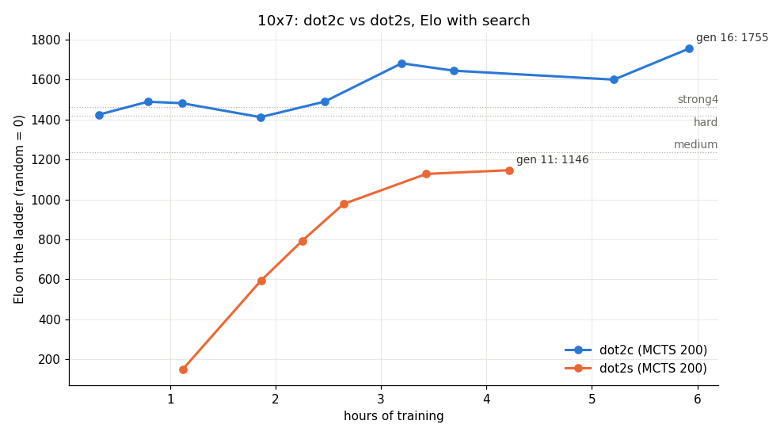

# dot2c vs dot2s: Elo against hours of training

Generated by `scripts/elo_vs_time.py` (2026-10-28 16:29). Hours = summed self-play + train + gate time up to the generation (pauses excluded). Elo on the 10x7 ladder, anchors: random 0, greedy 870, easy 873, medium 1237, hard 1420, strong 1267, strong4 1462.

| run | gen | hours | MCTS Elo | raw Elo |
|---|---:|---:|---:|---:|
| dot2c | 1 | 0.3 | 1425 | 1440 |
| dot2c | 2 | 0.8 | 1489 | 1425 |
| dot2c | 3 | 1.1 | 1482 | 1390 |
| dot2c | 5 | 1.9 | 1412 | 1439 |
| dot2c | 7 | 2.5 | 1489 | 1411 |
| dot2c | 9 | 3.2 | 1682 | 1431 |
| dot2c | 10 | 3.7 | 1645 | 1462 |
| dot2c | 14 | 5.2 | 1600 | 1481 |
| dot2c | 16 | 5.9 | 1755 | 1457 |
| dot2s | 3 | 1.1 | 150 | 150 |
| dot2s | 5 | 1.9 | 594 | 150 |
| dot2s | 6 | 2.3 | 792 | 249 |
| dot2s | 7 | 2.6 | 977 | 786 |
| dot2s | 9 | 3.4 | 1128 | 1030 |
| dot2s | 11 | 4.2 | 1146 | 1070 |
