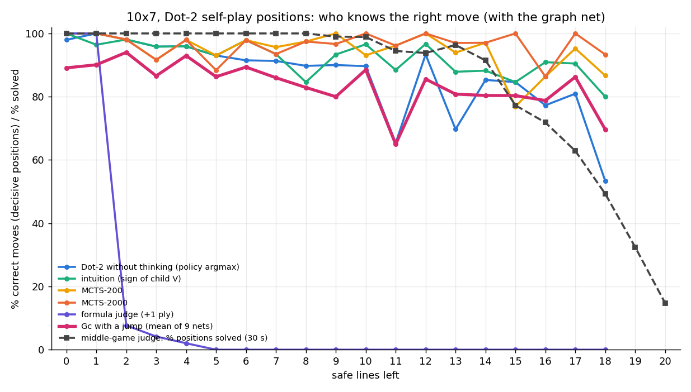

# Part 4, series 7: does the jump carry over to the middle game (evaluation only)

Generated by `scripts/graph_s7.py report` (2026-11-17 12:37). Protocol: docs/plan_part4.md (series 7), configs/graph_s7.yaml. No training. Nets: best point weights. Gc and C+h move: policy argmax over legal lines; Dot-2 without thinking: its policy argmax (dot2c gen 16), recomputed here. A move is correct when it keeps the best result of the judge's labels (part 3 (c), runs/mid_judge, not relabelled).

Sets: **mid** = 1925 solved positions at 10-15 safe lines, 721 decisive (primary); **chart** = 1510 solved positions at 0-18 safe lines, 630 decisive (descriptive).

## Primary and reading

D = mean of the 9 Gc nets with a jump - Dot-2 without thinking, decisive mid positions: **-2.4 points**, 95% interval [-4.7, -0.1] (bootstrap over positions and nets, 10000 resamples, seed 7).

Row of the protocol: **no transfer; Gc with a jump is below Dot-2 without thinking**.

| nets | n | mean on decisive mid % | Dot-2 without thinking % | difference | 95% interval |
|---|---:|---:|---:|---:|---:|
| Gc with a jump (primary) | 9 | 81.2 | 83.6 | -2.4 | [-4.7, -0.1] |
| Gc without a jump | 5 | 80.4 | 83.6 | -3.3 | [-6.1, -0.6] |
| C+h (series 3') | 5 | 75.8 | 83.6 | -7.8 | [-12.6, -3.1] |

Reference, Dot-2 on the same 721 decisive positions from the stored moves of runs/mid_judge/nets_mid.json (not rerun): intuition 91.0%, MCTS-200 95.6%, MCTS-2000 96.4%. The protocol quotes the user's 96.0 / 90.7%; docs/mid_judge.md has 95.6 / 91.0 on these positions.

Recomputed Dot-2 moves equal the stored hand moves of part 3: mid 1925/1925, chart 1510/1510.

## Overlap with the nets' training and selection positions

mid and chart positions against the judge's 10x7 train / validation / probe and the stage 0 10x7 train / validation of series 6 (Gc) and series 3' (C+h); key: minimum over the 4 grid symmetries. Cells: shared distinct positions. 5x5 positions cannot coincide with 10x7 ones.

Key: drawn lines only.

| | graph_s6: stage 0 train (20000) | graph_s6: stage 0 validation (2000) | graph_s6: judge train (4500) | graph_s6: judge validation (500) | graph_s6: judge probe (304) | graph_s3p: stage 0 train (20000) | graph_s3p: stage 0 validation (2000) | graph_s3p: judge train (4500) | graph_s3p: judge validation (500) | graph_s3p: judge probe (304) |
|---|---:|---:|---:|---:|---:|---:|---:|---:|---:|---:|
| mid (1925 distinct) | 0 | 0 | 0 | 0 | 0 | 0 | 0 | 0 | 0 | 0 |
| chart (1510 distinct) | 0 | 0 | 0 | 0 | 0 | 0 | 0 | 0 | 0 | 0 |

Key: full encoding (17 planes).

| | graph_s6: stage 0 train (20000) | graph_s6: stage 0 validation (2000) | graph_s6: judge train (4500) | graph_s6: judge validation (500) | graph_s6: judge probe (304) | graph_s3p: stage 0 train (20000) | graph_s3p: stage 0 validation (2000) | graph_s3p: judge train (4500) | graph_s3p: judge validation (500) | graph_s3p: judge probe (304) |
|---|---:|---:|---:|---:|---:|---:|---:|---:|---:|---:|
| mid (1925 distinct) | 0 | 0 | 0 | 0 | 0 | 0 | 0 | 0 | 0 | 0 |
| chart (1510 distinct) | 0 | 0 | 0 | 0 | 0 | 0 | 0 | 0 | 0 | 0 |

Data files: runs/graph_s6/data.npz sha256 bbddd4fa95553006; runs/graph_s3p/data.npz sha256 bbddd4fa95553006.

No mid position is shared with any training or selection position (by drawn lines, so not by the full encoding either).

Dot-2 is not in this check: the mid and chart positions come from its own self-play games (MCTS-200, part 3 (c)), so they are from its own distribution, which the Gc and C+h nets never trained on.

## Table 1. Nets

| group | net | mid all % | mid decisive % | chart decisive % (0-18) | weights sha256 |
|---|---|---:|---:|---:|---|
| Gc with a jump | Gc w8/101 | 93.7 | 83.2 | 89.0 | 685f67f03caca202 |
| Gc with a jump | Gc w8/102 | 93.0 | 81.3 | 84.3 | 56a8faa70368d723 |
| Gc with a jump | Gc w8/103 | 92.8 | 80.9 | 85.9 | 50adcea03d7c5c07 |
| Gc with a jump | Gc w8/104 | 93.3 | 82.1 | 84.9 | 241316fb70af09f9 |
| Gc with a jump | Gc w8/105 | 93.4 | 82.4 | 84.3 | 12ce54f956a91adf |
| Gc with a jump | Gc w9/104 | 92.3 | 79.3 | 85.1 | 05a6ecf09f20fa8c |
| Gc with a jump | Gc w9/105 | 92.2 | 79.1 | 82.2 | 4a3f694b90c91381 |
| Gc with a jump | Gc w6/103 | 93.2 | 82.0 | 86.5 | 8a1090498b038bc3 |
| Gc with a jump | Gc w6/104 | 92.9 | 81.0 | 85.9 | 0a6300161dbf4dfb |
| Gc without a jump | Gc w9/101 | 91.3 | 76.8 | 81.6 | ff594e3580a26314 |
| Gc without a jump | Gc w9/102 | 92.9 | 81.1 | 85.1 | 5c5ab9eb75c97899 |
| Gc without a jump | Gc w6/101 | 93.0 | 81.4 | 85.2 | c869b48612b6b035 |
| Gc without a jump | Gc w6/102 | 93.0 | 81.3 | 84.6 | 55c8ba551dfe5898 |
| Gc without a jump | Gc w11/101 | 92.9 | 81.1 | 85.4 | 0e1379a420f7fccd |
| C+h (series 3') | C+h s1 | 90.0 | 73.4 | 75.9 | cfe0327cac008c4b |
| C+h (series 3') | C+h s2 | 88.5 | 69.3 | 77.6 | 6fe21af6e4f7cb07 |
| C+h (series 3') | C+h s3 | 90.4 | 74.5 | 84.1 | 061c6ae9c382346b |
| C+h (series 3') | C+h s4 | 93.1 | 81.7 | 84.3 | 4f7b39f5906876e8 |
| C+h (series 3') | C+h s5 | 92.6 | 80.2 | 83.8 | 44bb8ee57ba5c39e |
| Dot-2 | without thinking | 93.9 | 83.6 | 88.9 | |

## Table 2. mid, decisive positions by safe lines left

% correct moves; group = mean over its nets. Dot-2 intuition / MCTS-200 from the stored moves of part 3.

| safe lines | n | Gc with a jump | Gc without a jump | C+h | Dot-2 without thinking | intuition | MCTS-200 |
|---:|---:|---:|---:|---:|---:|---:|---:|
| 15 | 92 | 70.7 | 69.6 | 64.6 | 73.9 | 82.6 | 91.3 |
| 14 | 122 | 81.9 | 80.5 | 74.1 | 82.0 | 89.3 | 95.1 |
| 13 | 105 | 80.0 | 79.4 | 76.6 | 78.1 | 91.4 | 97.1 |
| 12 | 123 | 83.6 | 82.6 | 76.4 | 87.8 | 93.5 | 96.7 |
| 11 | 124 | 76.4 | 75.5 | 72.1 | 82.3 | 91.9 | 96.0 |
| 10 | 155 | 89.8 | 89.4 | 85.8 | 92.3 | 94.2 | 96.1 |

## Table 3. chart, decisive positions by safe lines left

% correct moves; group = mean over its nets. Dot-2 intuition / MCTS-200 from the stored moves of part 3.

| safe lines | n | Gc with a jump | Gc without a jump | C+h | Dot-2 without thinking | intuition | MCTS-200 |
|---:|---:|---:|---:|---:|---:|---:|---:|
| 18 | 15 | 69.6 | 65.3 | 56.0 | 53.3 | 80.0 | 86.7 |
| 17 | 21 | 86.2 | 81.9 | 77.1 | 81.0 | 90.5 | 95.2 |
| 16 | 22 | 78.8 | 78.2 | 70.9 | 77.3 | 90.9 | 86.4 |
| 15 | 13 | 80.3 | 81.5 | 67.7 | 84.6 | 84.6 | 76.9 |
| 14 | 34 | 80.4 | 77.1 | 71.8 | 85.3 | 88.2 | 97.1 |
| 13 | 33 | 80.8 | 78.8 | 78.2 | 69.7 | 87.9 | 93.9 |
| 12 | 30 | 85.6 | 87.3 | 78.7 | 93.3 | 96.7 | 100.0 |
| 11 | 26 | 65.0 | 64.6 | 58.5 | 65.4 | 88.5 | 96.2 |
| 10 | 29 | 88.5 | 86.2 | 89.0 | 89.7 | 96.6 | 93.1 |
| 9 | 30 | 80.0 | 77.3 | 72.0 | 90.0 | 93.3 | 100.0 |
| 8 | 39 | 82.9 | 81.0 | 80.5 | 89.7 | 84.6 | 97.4 |
| 7 | 46 | 86.0 | 85.2 | 83.5 | 91.3 | 93.5 | 95.7 |
| 6 | 47 | 89.4 | 88.1 | 88.5 | 91.5 | 97.9 | 97.9 |
| 5 | 43 | 86.3 | 86.5 | 84.2 | 93.0 | 93.0 | 93.0 |
| 4 | 49 | 93.0 | 94.7 | 93.9 | 95.9 | 95.9 | 98.0 |
| 3 | 24 | 86.6 | 75.8 | 86.7 | 95.8 | 95.8 | 91.7 |
| 2 | 52 | 94.0 | 94.6 | 95.0 | 98.1 | 98.1 | 98.1 |
| 1 | 28 | 90.1 | 85.0 | 82.1 | 100.0 | 96.4 | 100.0 |
| 0 | 49 | 89.1 | 94.7 | 79.6 | 98.0 | 100.0 | 100.0 |

## Who knows what

The lines of docs/who_knows.png (part 3, stored moves; the judge's solved share from all chart positions) plus Gc with a jump (mean of the 9 nets). A point where a bucket has >= 10 decisive positions.
