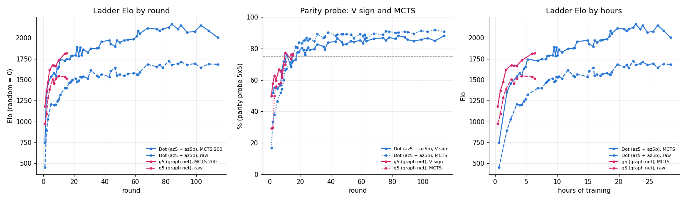

# Part 4, series 9: the graph net plays 5x5 (run g5)

Generated by `scripts/graph_s9.py report` (2026-11-17 20:25). Protocol: docs/plan_part4.md (series 9), configs/g5.yaml (= configs/az5b.yaml apart from the net, from scratch, and the run plumbing). Dot = az5 (rounds 1-31) then az5b (rounds 32-119) on the same ladder; round = generation (accepted or not).

State: 15 rounds done, 10 accepted, running. Training hours: 6.4 (to the last evaluated generation).

Workers and limits: from the start 2026-11-17: 6 self-play workers, no GPU memory limit, no nice (user: machine free today; 8 workers measured 19.5k vs 19.0k evals/s at 6, not worth it).

Stop rule (amendment, 2026-11-17, round 16): at least 117 rounds and the best MCTS Elo up by <= 20 over the last 20 rounds; 6 rejects in a row as the fallback; hard cap 250 rounds. Now: judged at round 15 of 117, best MCTS Elo 1816, fewer than 20 rounds of history.

Pace: self-play 23 min per round, 17994 evals/s (last 5 rounds).

## Comparison by rounds

| milestone | g5 round | Dot round (from the data) |
|---|---:|---:|
| Hard >= 90% with thinking (MCTS 200) | 6 | 11 (user: 17) |
| V sign on the parity probe >= 75% | 10 | 11 (user: 8) |

## Comparison by time

Elo (MCTS 200 / without thinking) of the last accepted, evaluated generation within H hours of training (self-play + train + gate seconds). Elo on the opponents of both ladders (random, greedy, medium, hard, strong).

| hours | g5 gen | g5 Elo MCTS / raw | g5 best MCTS Elo so far | Dot round | Dot Elo MCTS / raw | Dot best MCTS Elo so far |
|---:|---:|---|---:|---:|---|---:|
| 12 | 15 (not yet) | 1816 / 1513 | 1816 | 31 | 1870 / 1614 | 1895 |
| 24 | 15 (not yet) | 1816 / 1513 | 1816 | 90 | 2151 / 1713 | 2164 |
| 48 | 15 (not yet) | 1816 / 1513 | 1816 | 114 (Dot ended at 28.4 h) | 2005 / 1684 | 2164 |

## Rounds (accepted, evaluated generations)

Ladder: win % with MCTS 200 / without thinking, 100 games per cell. Parity probe 5x5 (1000 positions): policy argmax correct %, V child (sign of V after every move, balanced) %, MCTS 200 correct %.

| round | hours | gating % | vs random | vs greedy | vs easy | vs medium | vs hard | vs strong | Elo MCTS / raw | policy | V sign | MCTS |
|---:|---:|---:|---|---|---|---|---|---|---|---:|---:|---:|
| 1 | 0.4 | 97 | 100 / 100 | 83 / 58 | 73 / 59 | 37 / 16 | 15 / 8 | 7 / 1 | 1180 / 975 | 48.6 | 50.0 | 29.4 |
| 2 | 0.8 | 85 | 100 / 100 | 95 / 68 | 91 / 64 | 71 / 41 | 34 / 3 | 4 / 3 | 1372 / 1091 | 41.8 | 57.8 | 29.9 |
| 3 | 1.3 | 85 | 100 / 100 | 94 / 89 | 96 / 85 | 87 / 70 | 47 / 10 | 9 / 5 | 1473 / 1280 | 49.0 | 62.9 | 49.9 |
| 4 | 1.7 | 80 | 100 / 100 | 98 / 92 | 100 / 92 | 90 / 79 | 81 / 32 | 13 / 5 | 1618 / 1384 | 48.6 | 59.6 | 55.9 |
| 6 | 2.6 | 55 | 100 / 100 | 99 / 96 | 97 / 96 | 91 / 90 | 94 / 55 | 14 / 6 | 1673 / 1504 | 49.0 | 66.9 | 57.4 |
| 7 | 3.0 | 57 | 100 / 100 | 97 / 96 | 98 / 98 | 94 / 83 | 87 / 48 | 19 / 4 | 1670 / 1454 | 49.5 | 65.6 | 58.1 |
| 8 | 3.5 | 67 | 100 / 100 | 97 / 95 | 100 / 90 | 99 / 91 | 89 / 60 | 11 / 4 | 1666 / 1513 | 49.0 | 62.0 | 61.5 |
| 10 | 4.3 | 64 | 100 / 100 | 99 / 97 | 100 / 98 | 97 / 91 | 90 / 62 | 28 / 10 | 1732 / 1545 | 50.2 | 77.3 | 70.0 |
| 14 | 6.0 | 70 | 100 / 100 | 100 / 95 | 100 / 98 | 97 / 90 | 96 / 67 | 41 / 5 | 1812 / 1536 | 52.0 | 73.4 | 76.3 |
| 15 | 6.4 | 63 | 100 / 100 | 100 / 97 | 100 / 97 | 98 / 85 | 94 / 61 | 43 / 7 | 1816 / 1513 | 52.6 | 75.7 | 76.6 |

