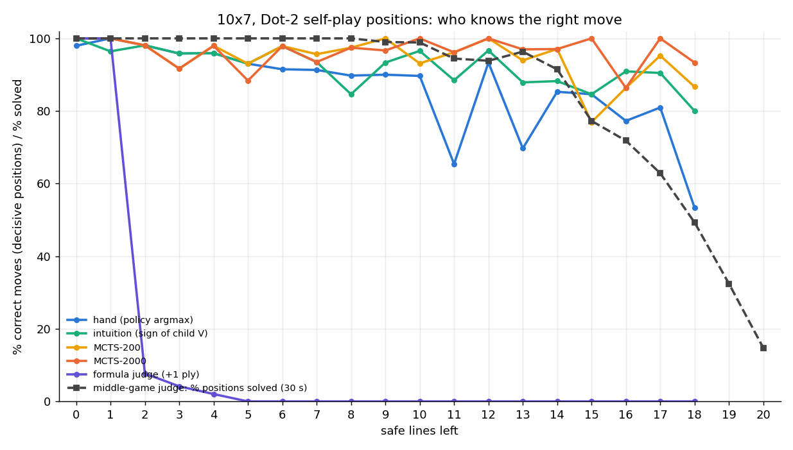

# Part 3 (c): a judge for the middle game of 10x7

Generated by `scripts/mid_judge_eval.py report` (2026-11-03 20:47), configs/mid_judge.yaml. Judge: sim/mid_judge.py + agents/csrc/mid_judge.c — exact search on the real board (captures and double-dealing as agents/strong.py; safe lines plus one representative per chain / loop), Berlekamp's recursion as the leaf of the loony endgame without junctions (the formula judge at s = 0, where it is exact), a transposition table of value bounds keyed by the canonical position over the 4 board symmetries, sacrifices tried before safe lines, null-window searches for the result sign only. *Solved* = every legal line has its result sign (win / draw / loss for the mover).

## Check against the exact judge (late 10x7 positions)

5000 positions of the part 3 (a) judge set (runs/parity_hand/data_10x7.jsonl, 1-2 safe lines, the move decides the result): every move's sign equal in 5000/5000, the position's result in 5000/5000. Time per position (all moves) median 0.03 s, max 0.2 s.

## How far it reaches

Positions from Dot-2 self-play on 10x7 (MCTS-200, temperature 1 for the first 10 lines; per game the first position with exactly s safe lines and no box to take). Per time limit its own run with a fresh table. Solved % (the position's result found % in brackets); median / max time of the solved ones. A limit is tried up to the first s where the shorter one solved nothing.

| safe lines | 10 s: n | solved % | median / max s | 60 s: n | solved % | median / max s | 600 s: n | solved % | median / max s |
|---:|---:|---:|---:|---:|---:|---:|---:|---:|---:|
| 5 | 40 | 100 (100) | 0.0 / 0.5 | 20 | 100 (100) | 0.0 / 0.5 | 8 | 100 (100) | 0.0 / 0.0 |
| 10 | 40 | 98 (98) | 0.0 / 1.3 | 20 | 100 (100) | 0.0 / 1.2 | 8 | 100 (100) | 0.0 / 1.2 |
| 15 | 40 | 72 (75) | 0.9 / 5.0 | 20 | 75 (85) | 1.0 / 3.0 | 8 | 88 (88) | 0.7 / 30.8 |
| 20 | 40 | 5 (15) | 2.3 / 3.6 | 20 | 20 (40) | 36.7 / 45.0 | 8 | 50 (50) | 241.4 / 570.7 |
| 30 | 40 | 0 (0) | — | 20 | 0 (0) | — | 8 | 0 (0) | — |

## Labelled set 'mid': safe lines 10-15

2000 positions (['games', 'games2', 'games3'].jsonl games), limit 60 s: solved 1925 (96.2%), decisive (not every move has the same result) 721.

Correct move = keeps the best result. Formula: sim/chain_solver.py ply_move; mid: this judge within 10.0 s; exact: agents/strong.py exact_move_values within 5.0 s (no answer = wrong).

| positions | n | hand | intuition | mcts200 | mcts2000 |
|---|---:|---:|---:|---:|---:|
| all solved | 1925 | 93.9 | 96.6 | 98.3 | 98.6 |
| decisive | 721 | 83.6 | 91.0 | 95.6 | 96.4 |

Decisive positions by safe lines left (% correct moves):

| safe lines | n | hand | intuition | mcts200 | mcts2000 |
|---:|---:|---:|---:|---:|---:|
| 15 | 92 | 74 | 83 | 91 | 97 |
| 14 | 122 | 82 | 89 | 95 | 96 |
| 13 | 105 | 78 | 91 | 97 | 96 |
| 12 | 123 | 88 | 93 | 97 | 98 |
| 11 | 124 | 82 | 92 | 96 | 94 |
| 10 | 155 | 92 | 94 | 96 | 97 |

## Labelled set 'chart': safe lines 0-20

1764 positions (games.jsonl games), limit 30 s: solved 1543 (87.5%), decisive (not every move has the same result) 641.

Correct move = keeps the best result. Formula: sim/chain_solver.py ply_move; mid: this judge within 10.0 s; exact: agents/strong.py exact_move_values within 5.0 s (no answer = wrong).

| positions | n | hand | intuition | mcts200 | mcts2000 | formula | mid | exact |
|---|---:|---:|---:|---:|---:|---:|---:|---:|
| all solved | 1543 | 95.5 | 97.1 | 98.3 | 98.4 | 10.6 | 94.1 | 56.1 |
| decisive | 641 | 89.1 | 93.1 | 95.8 | 96.3 | 12.9 | 92.4 | 57.7 |

Decisive positions by safe lines left (% correct moves):

| safe lines | n | hand | intuition | mcts200 | mcts2000 | formula | mid | exact |
|---:|---:|---:|---:|---:|---:|---:|---:|---:|
| 20 | 4 | 100 | 75 | 75 | 75 | 0 | 25 | 0 |
| 19 | 7 | 100 | 86 | 100 | 86 | 0 | 43 | 0 |
| 18 | 15 | 53 | 80 | 87 | 93 | 0 | 60 | 0 |
| 17 | 21 | 81 | 90 | 95 | 100 | 0 | 71 | 0 |
| 16 | 22 | 77 | 91 | 86 | 86 | 0 | 55 | 0 |
| 15 | 13 | 85 | 85 | 77 | 100 | 0 | 85 | 0 |
| 14 | 34 | 85 | 88 | 97 | 97 | 0 | 79 | 3 |
| 13 | 33 | 70 | 88 | 94 | 97 | 0 | 85 | 0 |
| 12 | 30 | 93 | 97 | 100 | 100 | 0 | 97 | 10 |
| 11 | 26 | 65 | 88 | 96 | 96 | 0 | 88 | 12 |
| 10 | 29 | 90 | 97 | 93 | 100 | 0 | 100 | 34 |
| 9 | 30 | 90 | 93 | 100 | 97 | 0 | 97 | 60 |
| 8 | 39 | 90 | 85 | 97 | 97 | 0 | 100 | 74 |
| 7 | 46 | 91 | 93 | 96 | 93 | 0 | 100 | 67 |
| 6 | 47 | 91 | 98 | 98 | 98 | 0 | 98 | 94 |
| 5 | 43 | 93 | 93 | 93 | 88 | 0 | 100 | 79 |
| 4 | 49 | 96 | 96 | 98 | 98 | 2 | 100 | 96 |
| 3 | 24 | 96 | 96 | 92 | 92 | 4 | 100 | 88 |
| 2 | 52 | 98 | 98 | 98 | 98 | 8 | 100 | 100 |
| 1 | 28 | 100 | 96 | 100 | 100 | 100 | 100 | 100 |
| 0 | 49 | 98 | 100 | 100 | 100 | 100 | 100 | 100 |

## Conclusions (2026-11-03, stopped before item 3 was finished)

1. **Correct.** C == Python reference == exact search on small boards
   (tests); on 10x7 every move's result sign equal on 5000/5000 late
   judge-set positions, median 0.03 s per position for all moves.
2. **Reach.** Solves (every move labelled) all positions with up to 10
   safe lines in seconds; at 15: 72% / 75% / 88% within 10 s / 60 s /
   10 min; at 20: 5% / 20% / 50% (solved ones take 4-10 min); at 30:
   nothing. Time grows roughly tenfold per 5 safe lines past 10. So the
   judge covers the late middle game (10-15 lines), not 20-40.
3. **Chart set** (0-18 safe lines, 1510 solved positions, 630 decisive):
   on decisive positions hand 89%, intuition 93%, MCTS-200 96%, MCTS-2000
   96.5%; the hand drops to 53-85% at 11-18 safe lines where MCTS stays
   at 86-100%. Formula judge: right whenever it answers, but on self-play
   positions it answers only at 0-1 safe lines (+1 ply needs every child
   settled). Exact Python judge (5 s): reaches ~8 safe lines.
4. **Set 'mid'** (finished 2026-11-03: 2000 positions at 10-15 safe lines,
   1925 solved, 721 decisive): on decisive positions hand 83.6%, intuition
   91.0%, MCTS-200 95.6%, MCTS-2000 96.4%. The hand is weakest at 13-15
   lines (74-78%); search fixes most of it, and MCTS-2000 gains little over
   MCTS-200 (+0.8 points) - the net's remaining errors here are not cured
   by ten times more simulations.
5. **Who knows what** (docs/who_knows.png, set 'chart' extended to 0-20
   safe lines): MCTS stays at 86-100% over the whole range, the hand
   drifts from ~98% at 0-2 lines to 53-85% at 15-18; the formula judge
   answers only at 0-1 lines; the strengthened judge solves ~100% up to 10
   lines, 77% at 15, 49% at 18, 15% at 20 (30 s). At 19-20 lines fewer
   than 10 decisive solved positions per point, so the players' curves end
   at 18.
